# Lunar Field Log · Phase 2.2 final review

Baselines are the committed Phase 2.1 checkpoint (`32b31d8`) and a production build of the incoming, uncommitted Phase 2.2 snapshot taken before finalization. The third build is the final feature branch working tree.

## Controls and interaction

Both baselines used world axes for movement. Once the camera orbited, pressing forward still moved the astronaut along world −Z. Phase 2.2 widened the orbit and used full-height collision discs to shorten the camera arm, so the direction mismatch and abrupt camera movement were easier to encounter. The camera now resolves the travel direction against the rendered horizontal view, damps yaw, pitch and follow distance, and checks ground and bounded obstacle clearance. Collision retracts the arm promptly, with a slower return to its normal distance.

Keyboard and touch input share normalized movement. Dragging while holding forward updates the travel direction continuously. Motion and walk blending use the collision-resolved velocity, with bounded toe-to-ground adjustments over slopes. Focus loss, touch cancellation, and opening a discovery panel clear held input. Auto-repeat cannot restart a cleared key, and the view freezes while the panel is open.

In the same drag and forward-hold trial, the normalized dot product between horizontal view and walking velocity went from **0.237** in Phase 2.1 and **0.148** in the incoming Phase 2.2 to **1.000** after the control fix. A dot product of 1 means both directions align. The four added regressions cover camera-relative axes and diagonal speed, finite obstacle and terrain clearance, held keys through orbit with reliable release, and rotated landscape touch movement with cancellation.

## Landscape and light

- The outer atlas separates the horizon into offset massifs with different profiles, an open basin, lower aprons and saddle terrain. Orientale-derived folds and debris detail blend into the walls. A vertex-sampled bedrock mask varies reflectance along gullies and exposed faces using the existing atlas.
- The detailed foreground carries forward. The coarse regolith carries angular fragments, and new mid-distance rocks use the existing instanced batches to connect the near trail to the basin. The relay reflector sits at a quieter scale while the trail, interaction position and operator reach stay in place.
- Low lateral sunlight separates bright crests from cooler sheltered slopes. Ground bounce and AgX roll off the silver highlights and keep shaded suit panels visible. The shader adds restrained backscatter near the light direction. The shadow map covers the walking area. On distant ridges, slope shading carries most of the depth.
- Earth retains its existing credited textures with updated ocean and cloud contrast, terminator shading and a thin atmospheric limb. The open basin gives Earth more sky in the spawn and Earth-facing views. The faint, synthetic starfield retains the black background.

Landscape references include [NASA’s Taurus–Littrow views](https://svs.gsfc.nasa.gov/4302), [the Orientale basin](https://svs.gsfc.nasa.gov/4499/) and [the CGI Moon Kit elevation data](https://svs.gsfc.nasa.gov/4720/).

## Matched browser screenshots

Each row uses identical world camera position, orientation, 48° vertical field of view, walker XZ, viewport, Balanced quality, and DPR 1 across the three production builds. The walker is grounded to the terrain in each build. Captures were taken after scene load, at 1440 × 900 on desktop and 390 × 844 on portrait. The final material and sun changes are visible in the comparisons. These are frames from the interactive scene, with fixed camera poses set through the local capture browser.

### Desktop spawn

Walker XZ `(0, 2.5)`, camera XYZ `(2.4, 3.06, 10.3)`, look-at XYZ `(0.35, 1.66, -1.4)`.

| Phase 2.1 | Incoming Phase 2.2 | Final Phase 2.2 |
| --- | --- | --- |
| 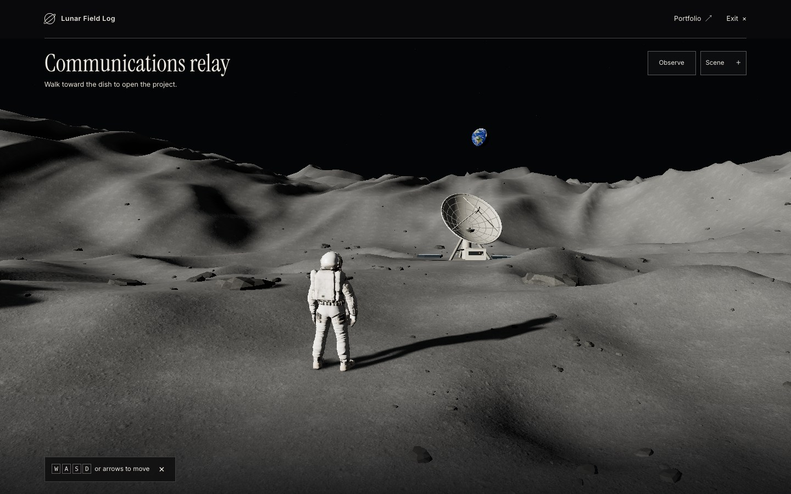 | 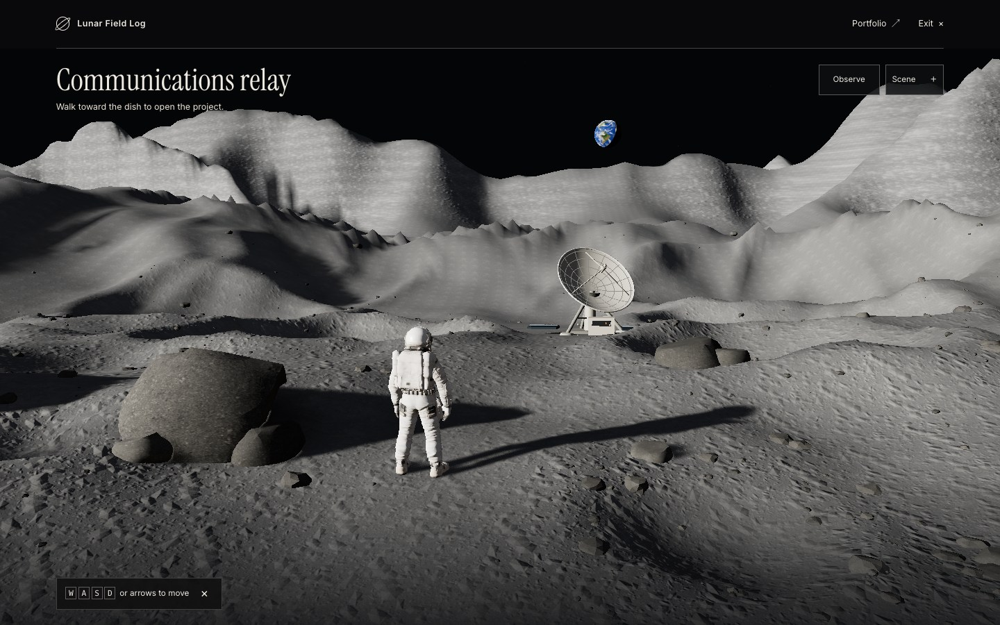 | 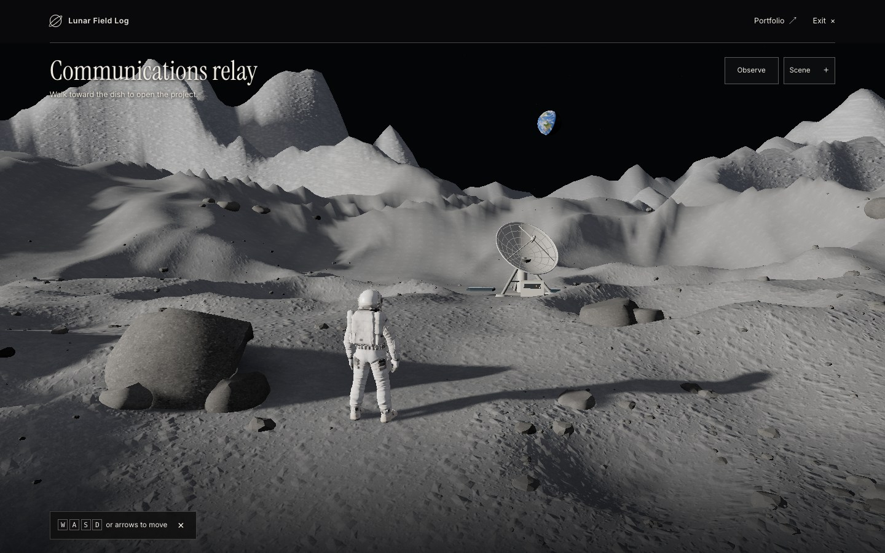 |

### Desktop relay approach

Walker XZ `(-0.45, -6.6)`, camera XYZ `(2.8, 3.24, 1.9)`, look-at XYZ `(0.35, 1.45, -12.5)`.

| Phase 2.1 | Incoming Phase 2.2 | Final Phase 2.2 |
| --- | --- | --- |
| 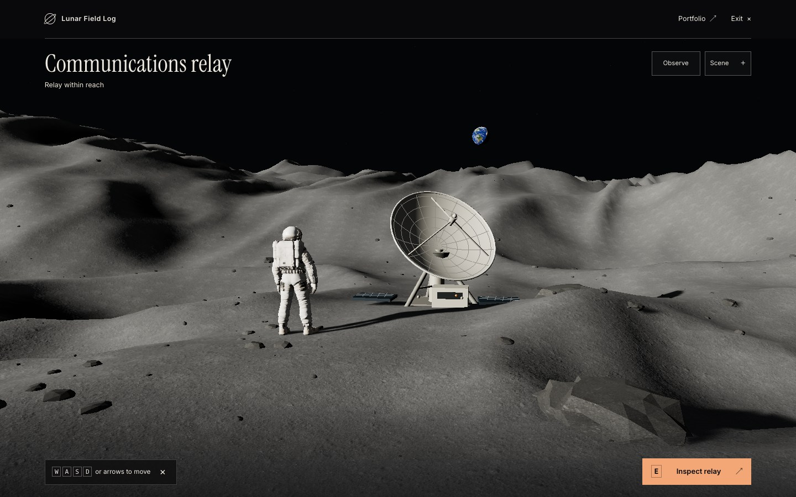 | 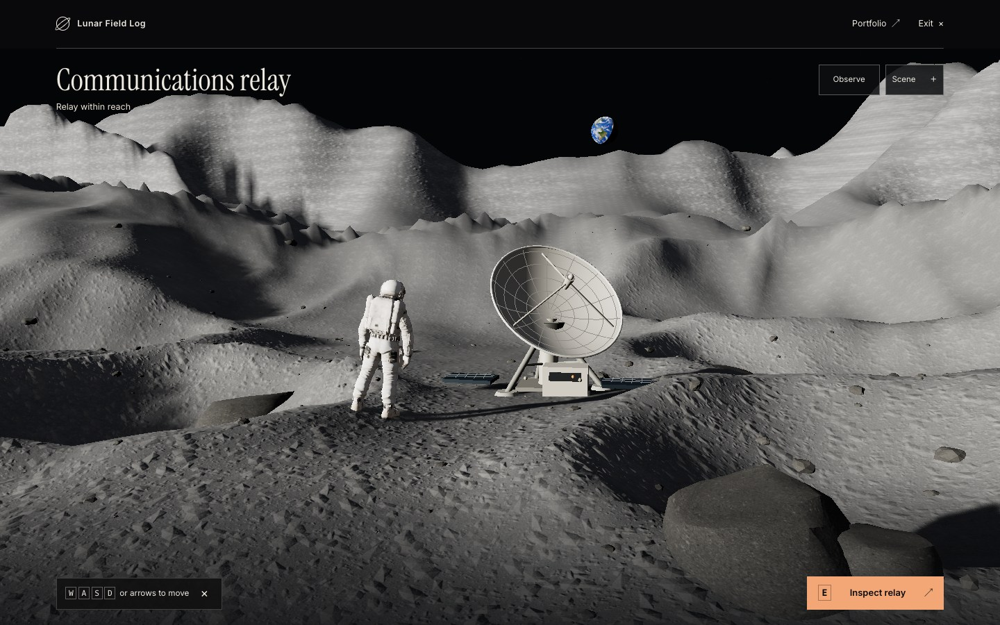 | 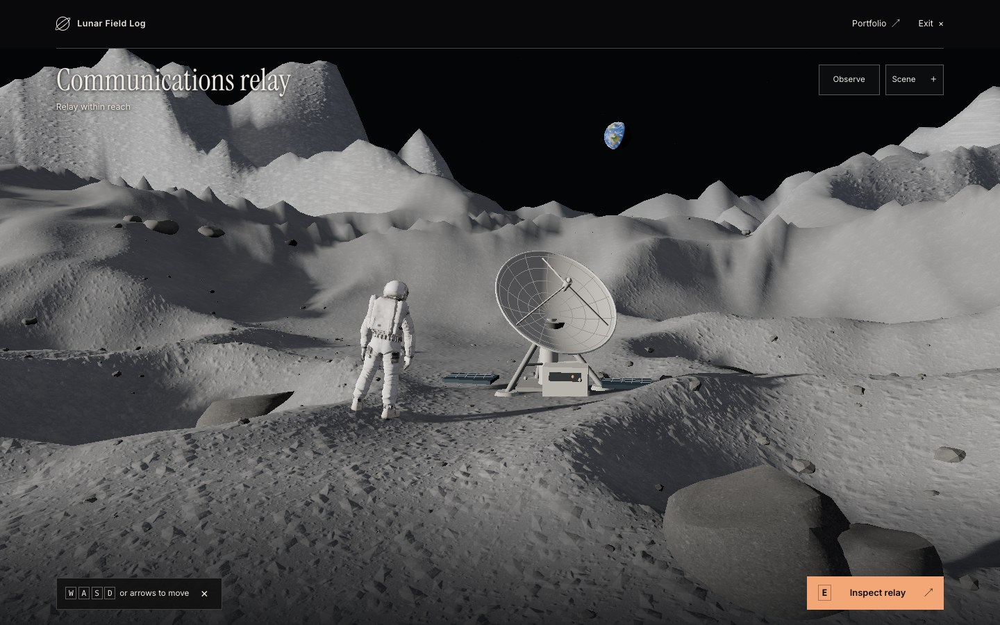 |

### Desktop distant mountains

Walker XZ `(0, 2.5)`, camera XYZ `(5.72, 3.35, 9.8)`, look-at XYZ `(-22.5, 5.5, -29.5)`.

| Phase 2.1 | Incoming Phase 2.2 | Final Phase 2.2 |
| --- | --- | --- |
| 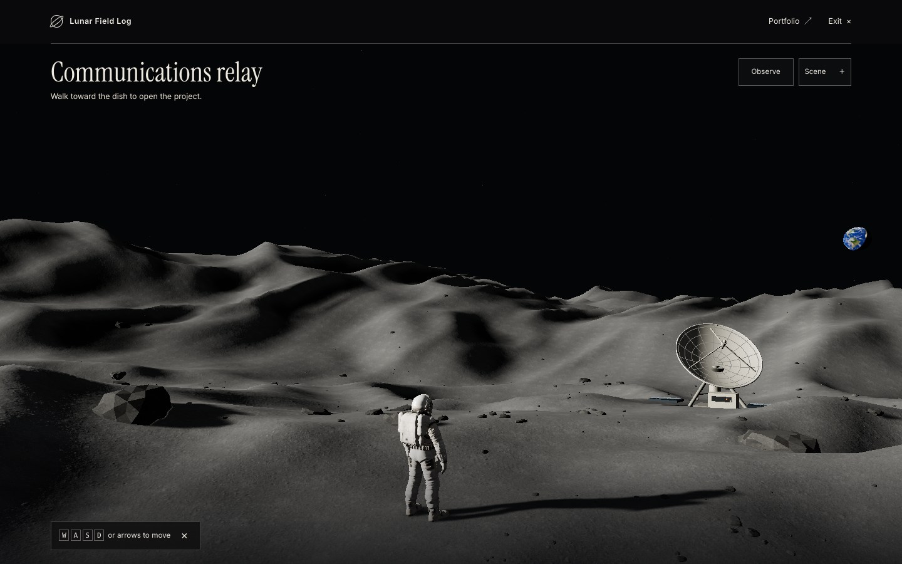 | 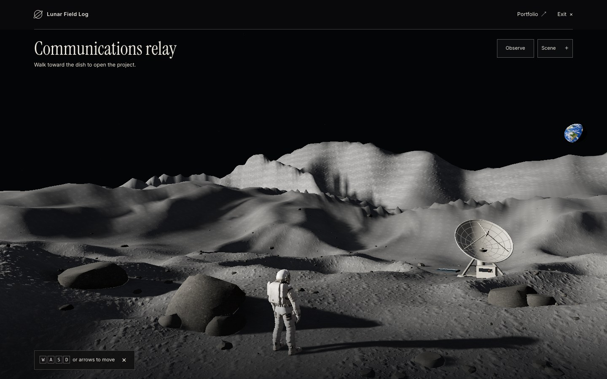 | 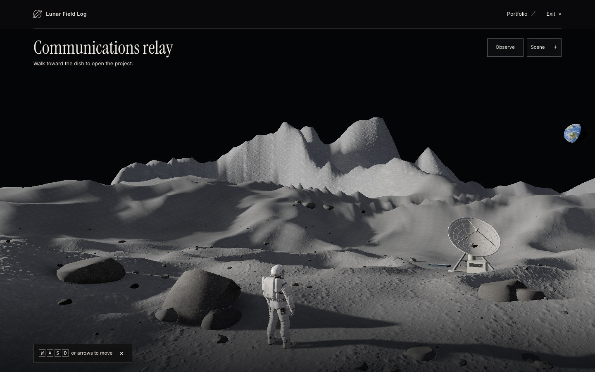 |

### Desktop Earth-facing view

Walker XZ `(0, 2.5)`, camera XYZ `(3.35, 3.9, 12.3)`, look-at XYZ `(0.38, 4.78, -13.3)`.

| Phase 2.1 | Incoming Phase 2.2 | Final Phase 2.2 |
| --- | --- | --- |
| 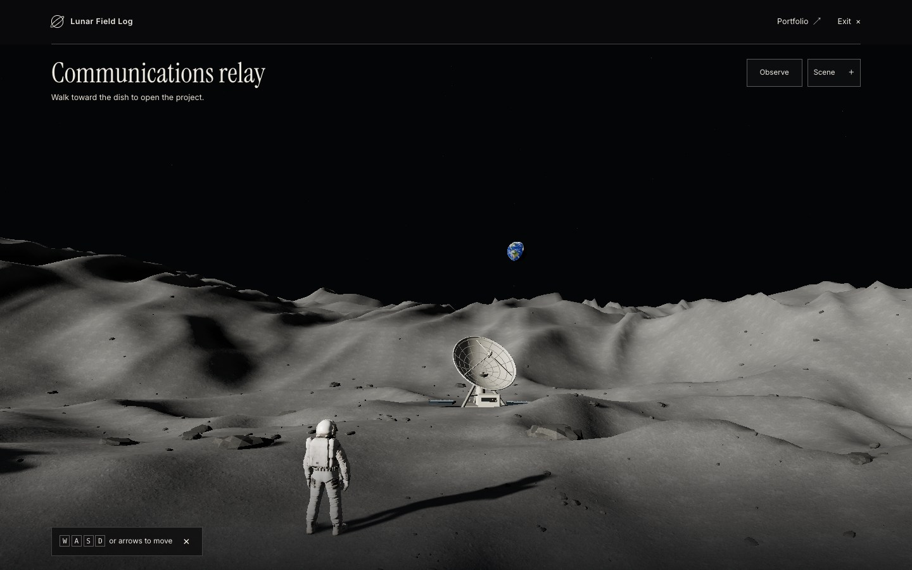 | 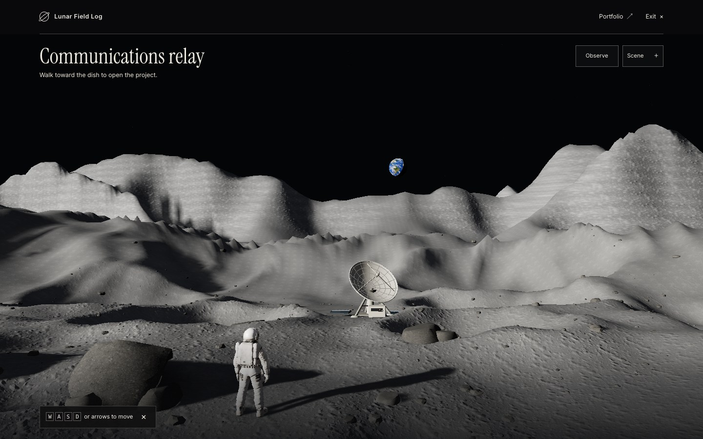 | 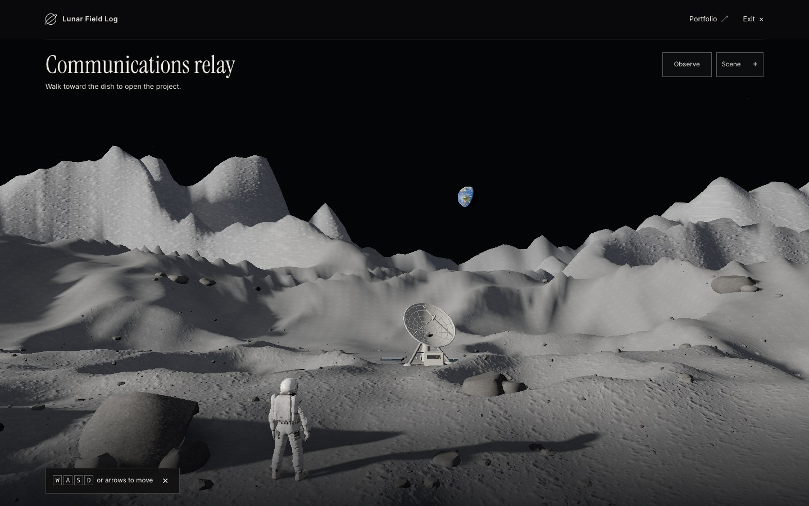 |

### Mobile portrait spawn

Walker XZ `(0, 2.5)`, camera XYZ `(0.3, 2.86, 9.15)`, look-at XYZ `(0.13, 1.26, -0.85)`.

| Phase 2.1 | Incoming Phase 2.2 | Final Phase 2.2 |
| --- | --- | --- |
| 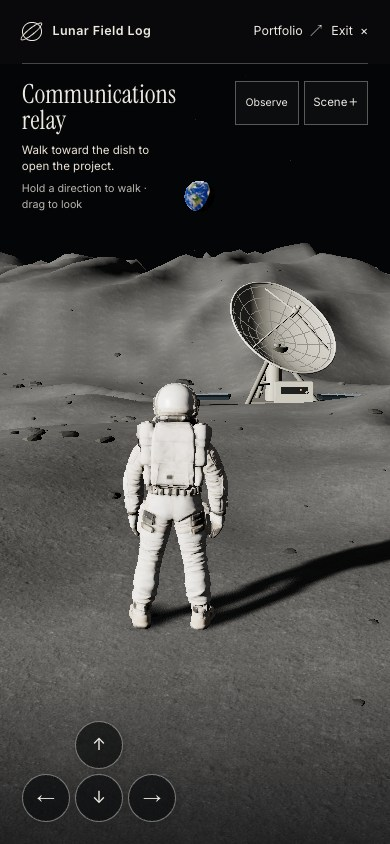 | 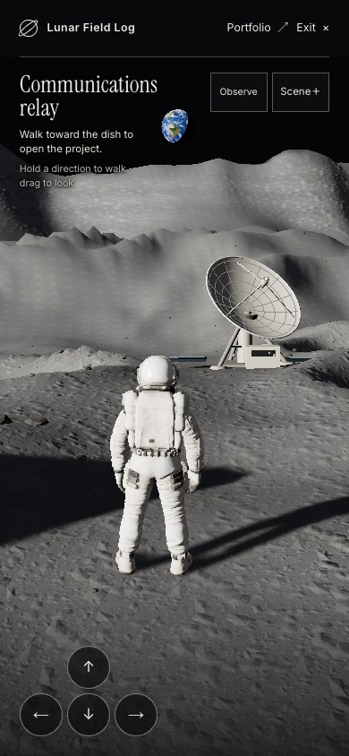 | 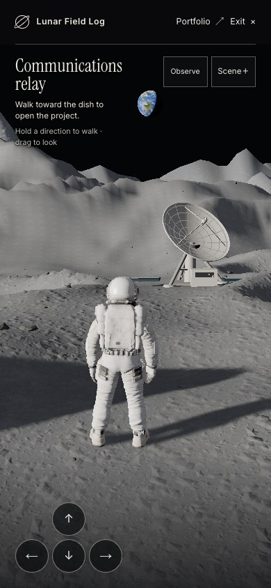 |

### Mobile portrait exploration

Walker XZ `(-0.35, -4.85)`, camera XYZ `(1.92, 3.02, 1.45)`, look-at XYZ `(-1.5, 1.65, -10.9)`.

| Phase 2.1 | Incoming Phase 2.2 | Final Phase 2.2 |
| --- | --- | --- |
| 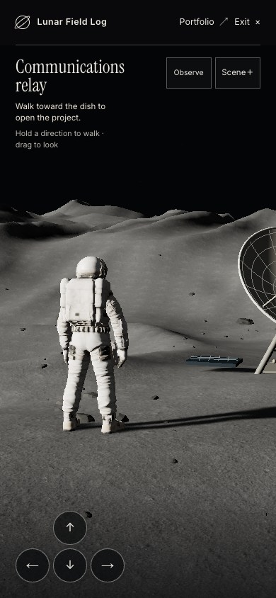 | 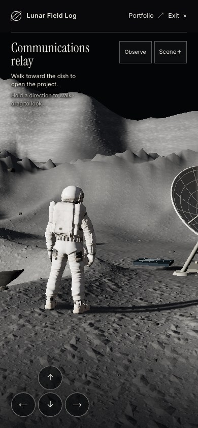 | 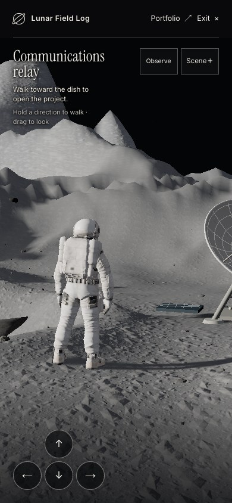 |

## Production performance

Chrome on an Apple M4 with Metal through ANGLE. Three fresh sessions per build and viewport. Medians from a 2.4-second forward-hold sample. The desktop viewport was 1440 × 900 at DPR 1, with a 1440 × 830 drawing buffer. Portrait was emulated at 390 × 844 and requested device DPR 2, with a 468 × 936 drawing buffer. The scene profiles use the default Auto quality; screenshots use explicit Balanced quality.

| Build | Viewport | FPS | P95 frame interval | Draw submissions | Submitted triangles | Explore transfer | Time to ready |
| --- | --- | ---: | ---: | ---: | ---: | ---: | ---: |
| Phase 2.1 | Desktop | 60.0 | 16.7 ms | 57.25 | 284,163 | 1,400,303 B | 459 ms |
| Incoming Phase 2.2 | Desktop | 60.0 | 16.7 ms | 60.26 | 280,949 | 1,599,018 B | 459 ms |
| Final Phase 2.2 | Desktop | 60.0 | 16.8 ms | 60.26 | 280,939 | 1,609,376 B | 457 ms |
| Phase 2.1 | Portrait | 60.0 | 16.8 ms | 57.26 | 284,173 | 1,400,303 B | 456 ms |
| Incoming Phase 2.2 | Portrait | 60.0 | 16.7 ms | 60.27 | 280,949 | 1,599,018 B | 458 ms |
| Final Phase 2.2 | Portrait | 60.0 | 16.7 ms | 60.27 | 280,949 | 1,609,376 B | 457 ms |

The final transfer increased by **10,358 B** from the incoming Phase 2.2 and **209,073 B** from Phase 2.1. The revised basin atlas accounts for 10,358 B of raw file growth and adds no GPU texture. The landing page made zero exploration asset requests at both profiled sizes and all eight tested sizes. Ready times are local and are not a WAN loading estimate.

## Verification

ESLint, strict TypeScript, and the Next.js production build passed. Playwright passed **23 of 23** cases against the production server, covering all eight viewport sizes, both touch orientations, reduced motion, fallback access without WebGL or JavaScript, failed asset loading, context loss, and adaptive quality.

A separate headed Chrome walkthrough exercised held and released keys, diagonal movement, orbit while walking, slopes, Observe and Walking views, the physical relay click target, the E shortcut, Escape focus restoration, High and Lite settings, direct portfolio navigation, and exit. Native input against the boulder at spawn and the relay respected the collider radii, stopping at approximately 1.65 and 2.37 scene units from their respective centers. The relay collision run placed the astronaut at a repeatable starting point before walking into the installation. Portrait touch emulation confirmed that forward follows a rotated camera and that cancellation stops movement with no page scroll.

The feature branch carries a Vercel Git rule disabling automatic deployments for `feat/lunar-field-log`. [Vercel Git configuration](https://vercel.com/docs/project-configuration/git-configuration#gitdeploymentenabled)

## Assets and limits

Phase 2.2 retains the project-authored ejecta detail map (111,238 B). The revised 97,235 B basin atlas uses NASA/GSFC LOLA elevation data, with original shaping, masks, and runtime geometry. Existing Earth maps remain CC BY 4.0, the regolith and astronaut remain CC0, and dependencies were unchanged. See the [asset ledger](asset-credits.md) for origins and reuse terms.

The distant terrain is a single-valued heightfield, so steep crags can still look rounded or faceted at some angles and cannot form overhangs. The layout compresses and recomposes real relief for an explorable scene, and stars are synthetic. Portrait and landscape touch were verified in Chromium emulation. Measurements do not establish physical iOS or Android frame rates, thermals, or battery consumption.
