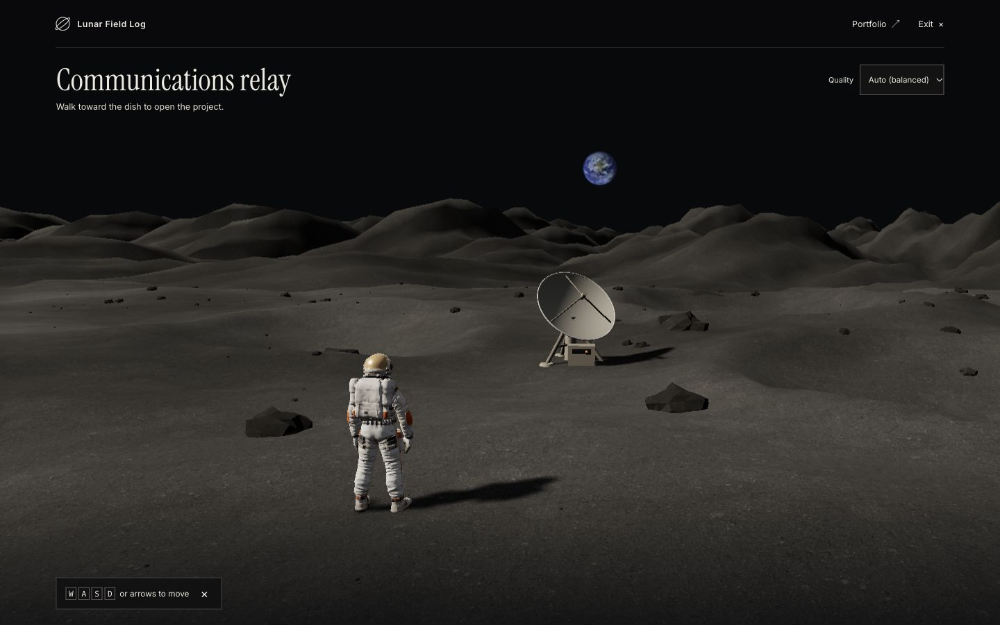
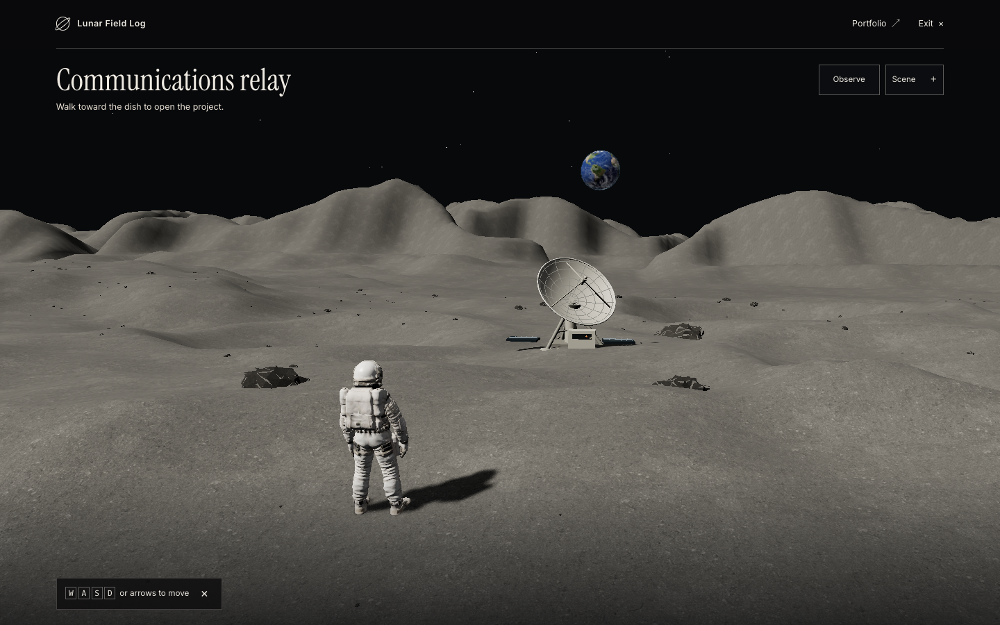
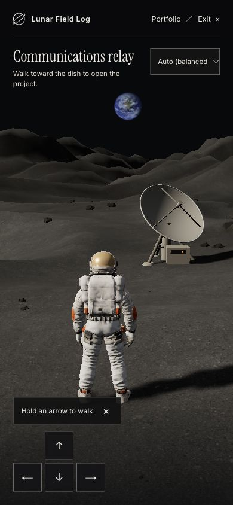
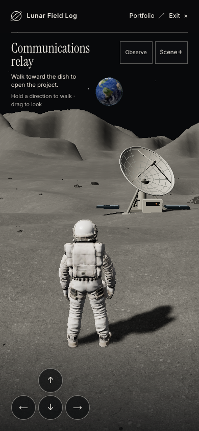

# Phase 2 — Lunar Field Log

Phase 2 makes the existing exploration scene more detailed and responsive while preserving the landing page, direct portfolio, keyboard and touch movement, MEETFLIX discovery, fallbacks and adaptive quality. The working branch is still `feat/lunar-field-log`; nothing has been committed, pushed, merged or deployed.

## Before and after

The saved Phase 1 captures are the before images; the new captures show the optimized production build at the same CSS viewport sizes.

| Phase 1 | Phase 2 |
| --- | --- |
|  |  |
|  |  |

The opening and first discovery are also captured:

- [Desktop landing](screenshots/phase2-landing-desktop.png)
- [Mobile landing](screenshots/phase2-landing-mobile.png)
- [MEETFLIX discovery panel in the scene](screenshots/phase2-discovery-desktop.png)

## Environment changes

### Surface and lighting

- A NASA LRO LOLA elevation crop is sampled bilinearly for both the far and near terrain mesh and the walker’s ground height. The global elevation TIFF stays out of the site; only a 512 × 512, 76 KB PNG crop ships.
- The terrain combines that elevation with five crater forms and sixteen individually parameterized distant massifs. The shapes include irregular shoulders, fractured ridges and scars, replacing the repeated sinusoidal ridge profile.
- Existing Poly Haven CC0 regolith maps remain local. The desaturated pale-grey albedo, normal detail, broad vertex variation, irregular instanced rocks and rough PBR material provide texture at walking distance. Quality tiers adjust terrain subdivision, rocks, DPR and shadows.
- A directional sun, diffuse fill, shadows and contact shading preserve high contrast without turning the surface dark brown. The geometry remains a lightweight authored approximation; it is not a full global photogrammetric terrain model.

### Space and ambient motion

- Earth now uses separate local 1024 × 512 surface and cloud textures from Solar System Scope. A lit globe, independently rotating cloud shell and subtle atmosphere rim create a readable day/night boundary.
- A seeded field of 760 restrained stars adds scale without a nebula or colorful sky effects.
- Small instanced grains rise and settle briefly around footsteps. Earth, clouds, antenna servo and the astronaut’s idle breathing update at a low rate while standing still; motion sleeps while the tab is hidden or the project dialog is open.

### Astronaut and discovery

- The existing CC0 astronaut rig and walk clip are retained. Saturated orange texture panels were neutralized, the suit material made more fabric-like, and the GLB was reduced from 13.99 MB to 895 KB.
- The ground probe now checks both toe bones against the same height sampler as the terrain and eases a bounded root correction. The scene also aligns the astronaut to the local terrain normal, eases turns, blends between idle and the walk clip, and adds a quiet idle breathing pose.
- This is toe-informed root correction, not independent foot placement or full leg inverse kinematics. Steep slopes and individual stride contact remain areas for a later rig pass.
- The relay now has a ribbed reflector, feed, gimbal, instrument housing, solar panels and a slowly moving servo. Existing proximity, E-key, click, mobile inspection, focus management and keyboard dismissal remain available. The content panel explicitly says the case study is in preparation because verified MEETFLIX details have not been supplied.
- Desktop and touch users can drag open ground to look around; an Observe control widens the view. Touch drag and directional movement are separate, and the directional buttons retain pointer cancellation handling.

## Assets, licensing and dependencies

Phase 2 adds no npm dependency. It uses the existing Three.js, React Three Fiber and Playwright setup. The Phase 1 landing artwork, fonts and favicon are carried forward.

| Asset | License / credit | Shipped preparation |
| --- | --- | --- |
| NASA LRO LOLA height sample | NASA/GSFC visualization data, derived from LRO LOLA | Centered crop, 512 × 512 PNG; 76 KB. Global 31.7 MB TIFF excluded. |
| Earth albedo and cloud map | Solar System Scope, CC BY 4.0 | Two local 1024 × 512 WebP maps, 203 KB combined. Credited in the colophon. |
| Astronaut in Spacesuit | Grab3D, CC0 1.0 | Existing rig retained; panel color and material adjusted, Meshopt-optimized to 895 KB. |
| Regolith albedo and normal maps | Dario Barresi / Poly Haven, CC0 | Existing local maps retained. |
| Terrain, relay, starfield and dust | Project-authored geometry and shaders | Generated in code; no extra model or runtime texture download. |

See [asset credits](asset-credits.md) for source URLs, preparation details and exact file sizes.

## Performance comparison

The saved Phase 1 baseline and Phase 2 were measured with Chrome 158 on an Apple M4 using ANGLE Metal. Phase 2 was measured from the production build. Portrait is Playwright device emulation on that same laptop, not a phone. The saved Phase 1 profile does not record its server mode, so timings are indicative rather than a controlled paired benchmark.

| Measurement | Phase 1 desktop | Phase 2 desktop | Phase 1 portrait emulation | Phase 2 portrait emulation |
| --- | ---: | ---: | ---: | ---: |
| Cold landing transfer | 448,957 B | 449,299 B | 332,451 B | 332,793 B |
| Encoded landing JavaScript | 138,540 B | 138,540 B | 138,540 B | 138,540 B |
| Landing scene assets requested | 0 | 0 | 0 | 0 |
| LCP, three local samples | 52–100 ms | 48–68 ms | 56 ms | 44–56 ms |
| CLS | 0 | 0 | 0 | 0 |
| Scene asset transfer | 1,130,088 B | 1,357,366 B | 1,130,088 B | 1,357,366 B |
| First scene request to ready UI | 458.5–467.5 ms | 448.4–459.2 ms | 456.1–458.4 ms | 453.3–457.7 ms |
| Active animation frame rate | ~60 FPS | ~60 FPS | ~60 FPS | ~60 FPS |
| Frame interval p95 | 16.7–16.8 ms | 16.7 ms | 16.7–16.8 ms | 16.7–16.8 ms |
| Instrumented WebGL draw calls per frame | ~41 | ~58 | ~41 | ~58 |

Each profile used three cold contexts per viewport and measured 2.4 seconds of held-forward movement. Frame counts and draw calls are measured by browser instrumentation, not GPU timings. The added Earth and elevation assets increase scene transfer by about 20%; landing transfer changes by 342 bytes. The richer world raises observed draw submissions by about 41%, while this laptop remained at its display-limited ~60 FPS. A low-end phone’s thermal, GPU and memory behavior cannot be inferred from this run; physical-device profiling is still required.

## Verification

On the production build:

- `npm run lint` — passed.
- `npm run typecheck` — passed with strict TypeScript.
- `npm run build` — passed; all seven routes prerendered as static pages.
- `npm test` — 15 Playwright tests passed.
- Chrome checked landing and portfolio links across eight viewports (320 × 568 through 1920 × 1080), zero scene downloads before entry, keyboard movement, touch movement and cancellation, touch drag-to-look, dialog pause/focus return, adaptive quality, reduced motion, missing WebGL, failed model loading, context loss, repeated entry and responsive canvas sizing. Simulation tests cover frame-rate-independent movement, world and relay collision, shared LOLA terrain height and bounded/eased toe correction.

Playwright’s bundled Chromium executable was unavailable in this environment; the suite used installed Google Chrome 158. The production browser emitted the upstream Three.js `Clock` deprecation notice from the current React Three Fiber stack; it did not affect checks.

## Run locally and check on a phone

```sh
npm ci
npm run dev
```

Open [http://localhost:3000](http://localhost:3000). Use WASD or arrow keys, drag open ground to look, choose Observe for a wider view, and approach the relay to inspect it. On touch screens, hold the direction buttons to walk and drag open ground to look.

For the browser suite, install Playwright’s browser with `npx playwright install chromium`, then run `npm test`. If using Chrome on macOS instead:

```sh
PLAYWRIGHT_CHROMIUM_PATH='/Applications/Google Chrome.app/Contents/MacOS/Google Chrome' npm test
```

To check a physical phone on the same Wi-Fi, start the dev server on the local network interface with `npm run dev -- --hostname 0.0.0.0`, find the laptop’s LAN IP, then open `http://<laptop-LAN-IP>:3000/explore` on the phone. Check first load, orbit drag, directional holds and cancellation, relay proximity/inspection, portrait/landscape, reduced-motion fallback and sustained walking. Physical iOS Safari and Android Chrome have not been tested yet.

## Next milestone and remaining input

The next release milestone is physical iOS/Android profiling and visual tuning, followed by a complete MEETFLIX case study using Akshat’s verified role, summary, technologies, highlights, approved screenshots and public links. Do not invent these details. Add further stations only after Weather Intelligence and LinguaCert AI project facts are verified.
